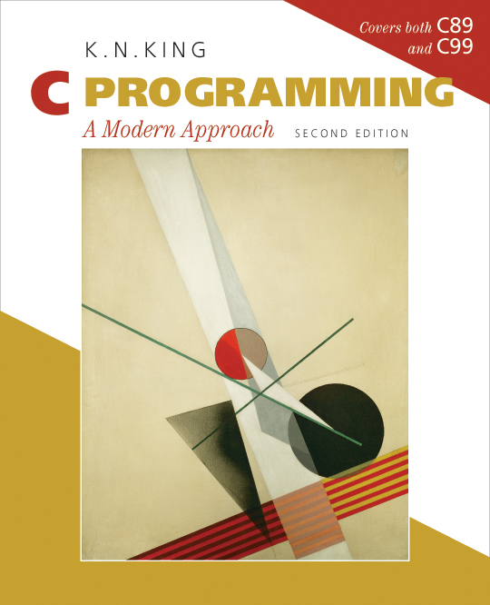

## c-solutions

Solutions to exercises and programming projects from the second edition of
[C Programming: A Modern Approach](http://knking.com/books/c2/index.html) by K.
N. King.

<table>
  <tr>
    <th>
      
    </th>
  </tr>
</table>
<sup>
  Source:
  <a href="http://knking.com/books/c2/cover.html">
    http://knking.com/books/c2/cover.html
  </a>
</sup>

#

### Structure

```text
.
├── 02
│   ├── exercises
│   │   ├── 01
│   │   ├── 02
│   │   └── ...
│   └── projects
│       ├── 01
│       ├── 02
│       └── ...
└── ... (other chapters)
```

#

### Compile

Single-file programs:

```sh
$ gcc -O -Wall -W -pedantic -ansi -std=c99 -o program program.c
```

Multi-file programs:

```bash
$ make
```
